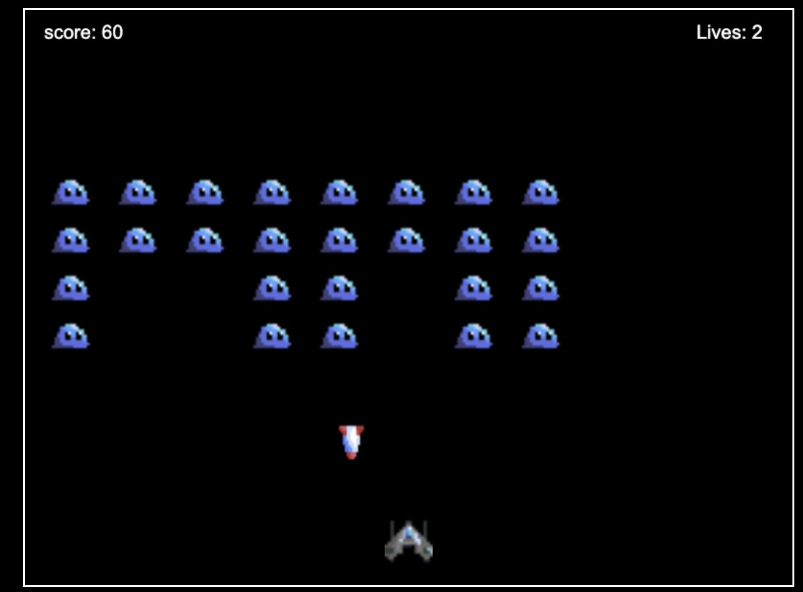
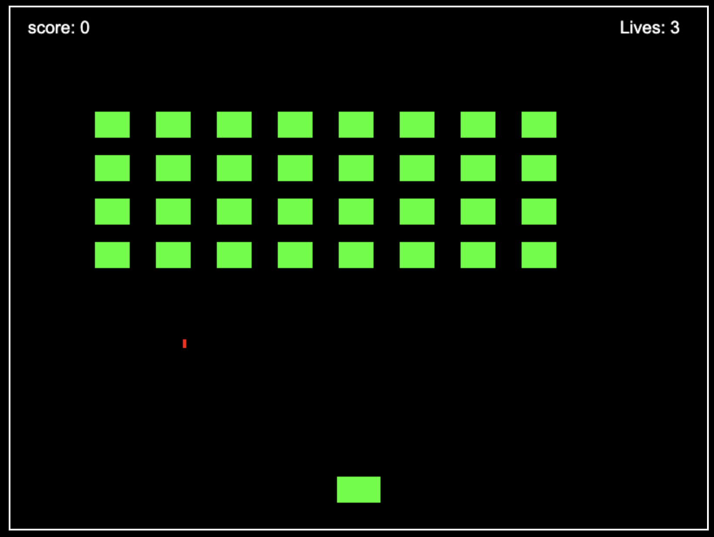

# Space Invaders — JavaScript, Docker & Kubernetes

A browser-based Space Invaders game built with HTML, CSS, and JavaScript, featuring original pixel-art graphics created in LibreSprite.

The project is containerized with Docker and deployed locally using Kubernetes.

## Game Screenshot



## Original Pixel Art

All game sprites were created from scratch using LibreSprite.

| Player | Alien |
|---|---|
|  |  |

| Player Rocket | Alien Rocket |
|---|---|
|  |  |

## Original Space Invaders Gameplay



## Features

- Player movement using keyboard controls
- Player-fired rockets
- Alien movement and alien-fired rockets
- Collision detection
- Player invincibility mechanic
- Custom pixel-art player, alien, and rocket sprites
- Sprite rendering using the HTML Canvas API

## Technologies Used

- HTML5
- CSS3
- JavaScript
- Canvas API
- Git and GitHub
- Docker
- Kubernetes
- YAML
- LibreSprite

## Project Structure

```text
space-invaders-kubernetes/
├── images/
│   ├── player.png
│   ├── blue-slime.png
│   ├── player-rocket.png
│   ├── alien-rocket.png
│   └── space-invaders-screenshot.png
├── k8s/
│   ├── deployment.yaml
│   └── service.yaml
├── index.html
├── Dockerfile
└── README.md
```

## Run Locally

1. Clone the repository:

```bash
git clone https://github.com/kyle-yang27/space-invaders-kubernetes.git
```

2. Open the project folder:

```bash
cd space-invaders-kubernetes
```

3. Open `index.html` in your browser.

## Run with Docker

Build the Docker image:

```bash
docker build -t space-invaders .
```

Run the container:

```bash
docker run -d -p 8080:80 --name space-invaders-container space-invaders
```

Open the game at:

```text
http://localhost:8080
```

## Deploy with Kubernetes

Apply the Kubernetes Deployment and Service:

```bash
kubectl apply -f k8s/
```

Check deployment status:

```bash
kubectl get deployments
kubectl get pods
kubectl get services
```

Access the game at:

```text
http://localhost:30080
```

## What I Learned

Through this project, I practiced:

- Building an interactive browser-based game with JavaScript.
- Drawing and integrating original pixel-art assets.
- Using the HTML Canvas API to render game graphics.
- Managing game entities, movement, and collision detection.
- Creating Docker images and running containers.
- Deploying applications using Kubernetes Deployments and Services.
- Managing source code and project changes with Git and GitHub.


<!-- # Space Invaders — Docker and Kubernetes Deployment

A browser-based Space Invaders game built with HTML, CSS, and JavaScript. This project demonstrates containerization with Docker and deployment to a local Kubernetes cluster.

## Gameplay Screenshot


## Project Goals

- Build and run a browser-based game.
- Version-control the project using Git and GitHub.
- Containerize the application using Docker.
- Deploy and manage the application using Kubernetes.

## Technologies

- HTML
- CSS
- JavaScript
- Git and GitHub
- Docker
- Kubernetes
- Nginx

## Run Locally

1. Clone this repository.
2. Open `index.html` in your web browser.

## Run with Docker

Build the Docker image:

```bash
docker build -t space-invaders .
```

Start the container:

```bash
docker run --rm -p 8080:80 space-invaders
```

Open [http://localhost:8080](http://localhost:8080) in your browser.

Press `Control + C` in the terminal to stop the container.

## Deploy to Kubernetes

Ensure Docker Desktop is running and its local Kubernetes cluster is enabled.

Apply the Kubernetes configuration:

```bash
kubectl apply -f k8s/
```

Check the deployment:

```bash
kubectl get deployments
kubectl get pods
kubectl get services
```

Access the application through port forwarding:

```bash
kubectl port-forward service/space-invaders 8081:80
```

Keep the command running and open [http://localhost:8081](http://localhost:8081) in your browser.

## Project Status

- [x] Browser-based game
- [x] Git and GitHub version control
- [x] Docker containerization
- [x] Kubernetes Deployment and Service
- [x] Local Kubernetes access through port forwarding

## Future Improvements

- Improve the Kubernetes access configuration.
- Add screenshots or a gameplay demonstration.
- Document deployment troubleshooting and lessons learned.
 -->


<!-- 
# Space Invaders — Kubernetes Deployment

A browser-based Space Invaders game built with HTML, CSS, and JavaScript. This project will demonstrate how to package a web application with Docker and deploy it to a local Kubernetes cluster.

## Project Goals

- Build and run a browser-based game.
- Version-control the project with Git and GitHub.
- Containerize the application using Docker.
- Deploy and manage the application using Kubernetes.

## Technologies

- HTML
- CSS
- JavaScript
- Git and GitHub
- Docker *(planned)*
- Kubernetes *(planned)*

## Run Locally

1. Clone this repository.
2. Open `index.html` in your web browser.

## Project Status

The initial game source code is committed to GitHub. Docker containerization and Kubernetes deployment are upcoming steps. -->